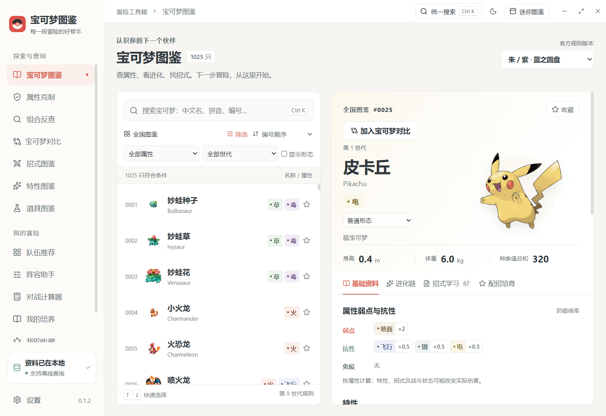
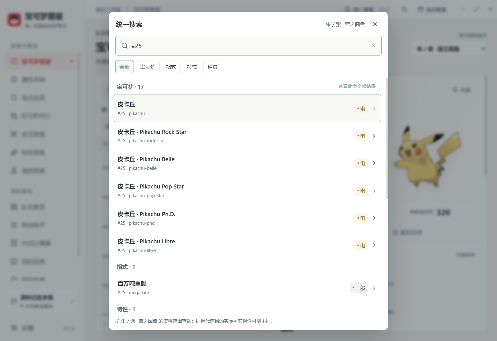
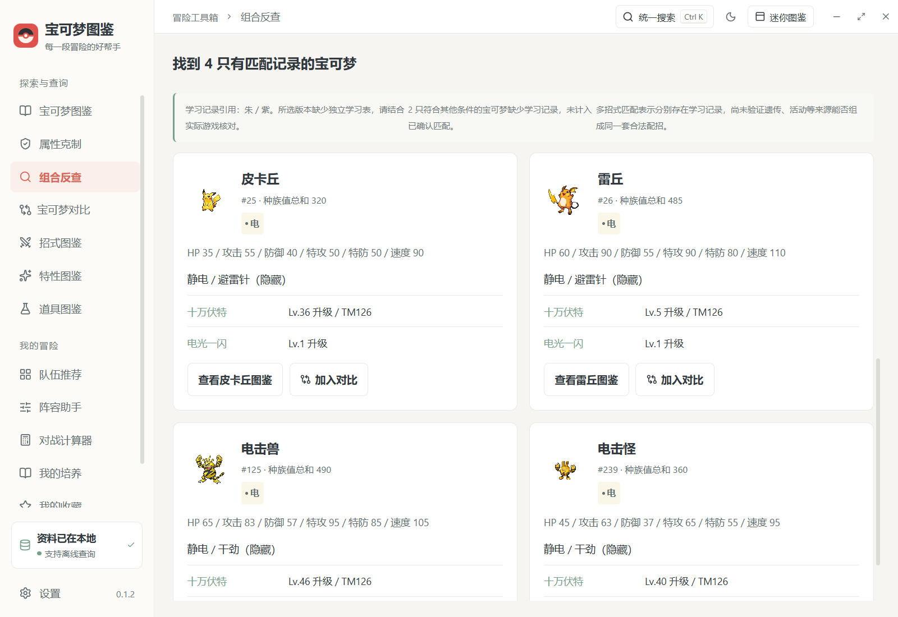
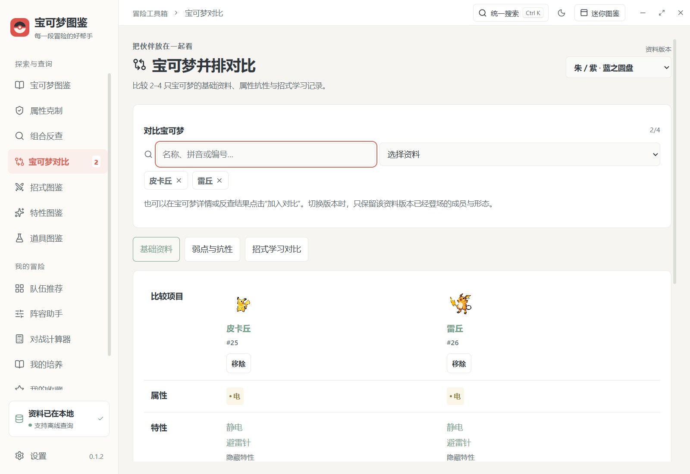
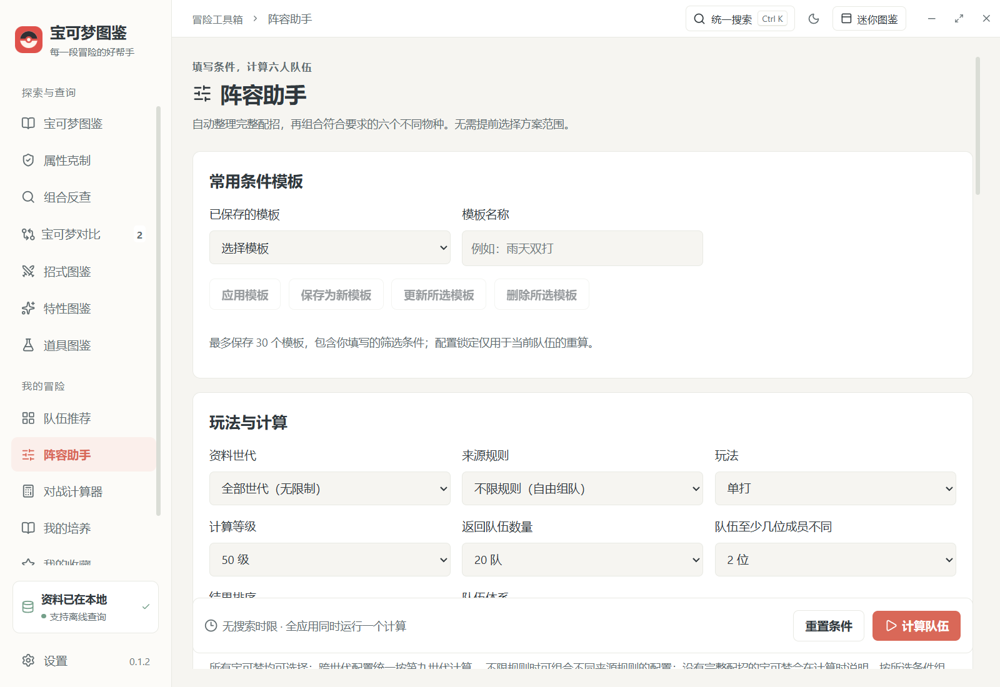
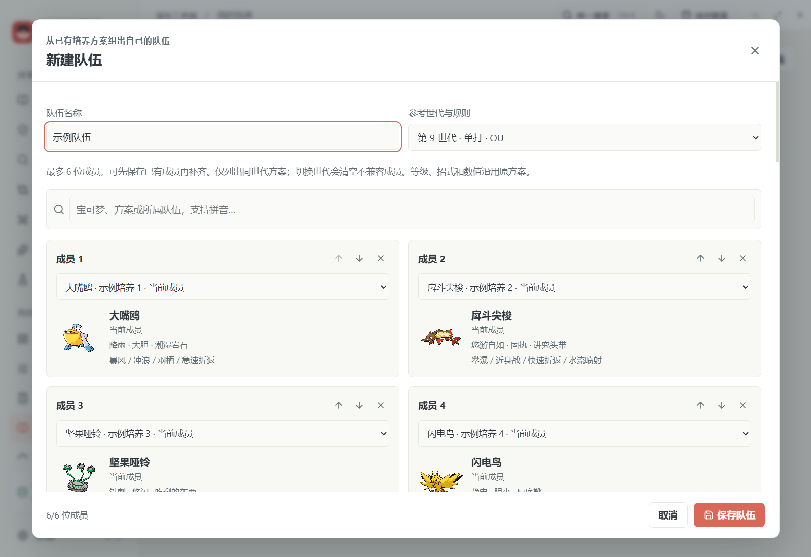

# 宝可梦图鉴（Windows 桌面版）

一款面向 PC 玩家使用的中文宝可梦资料与队伍管理工具。图鉴资料准备完成后，宝可梦查询可离线使用。

本仓库提供应用源码和必要的小型配置文件。为控制仓库体积，图鉴数据库和宝可梦图片不随源码分发；程序图标等必要的小型资源仍包含在仓库中。首次运行桌面应用前，请按下文生成图鉴资料。

## 界面预览

以下截图展示图鉴查询、队伍工具和迷你窗口。工作台截图使用示例培养方案。

<table>
  <tr>
    <td width="50%" align="center">
      
<strong>全国图鉴与宝可梦详情</strong>

      
    </td>
    <td width="50%" align="center">
      
<strong>统一搜索</strong>

      
    </td>
  </tr>
  <tr>
    <td width="50%" align="center">
      
<strong>组合反查</strong>

      
    </td>
    <td width="50%" align="center">
      
<strong>宝可梦对比</strong>

      
    </td>
  </tr>
  <tr>
    <td width="50%" align="center">
      
<strong>阵容助手</strong>

      
    </td>
    <td width="50%" align="center">
      
<strong>队伍工作台</strong>

      
    </td>
  </tr>
  <tr>
    <td colspan="2" align="center">
      
<strong>迷你图鉴固定标签</strong>

      
    </td>
  </tr>
</table>

## 功能说明

### 宝可梦图鉴

- 浏览全国图鉴，按世代、属性和编号筛选或排序。
- 使用中文名、拼音、拼音首字母、编号及常见旧译名搜索。
- 查看不同形态、属性、种族值、特性、蛋群、捕获率、孵蛋周期和努力值收益。
- 查看属性克制关系、进化链及进化条件。
- 按游戏版本查看招式学习方式；不完整或跨版本引用的资料会在界面中注明。

### 组合反查、宝可梦对比与统一搜索

- “组合反查”支持名称／拼音、最多两个同时具备的属性、普通／隐藏特性、各项种族值与总和范围，以及最多四个同时有学习记录的招式。结果分页显示，并附对应的升级、招式机、遗传、教学等记录，可直接查看图鉴或加入对比。
- 反查按当前资料版本匹配；DLC 引用基础版本时注明来源。缺少学习记录的成员不计为已确认匹配，整个版本缺表时明确提示资料不足。多招式记录的交集不等于已验证遗传、活动等来源的组合合法性。
- “宝可梦对比”可以选择 2–4 只宝可梦或形态，并排查看历史种族值、普通／隐藏特性、属性防御倍率及招式学习方式。支持共同招式、仅一位成员有记录的招式和全部记录；成员学习资料不完整时不判定共同或独有。可从宝可梦详情或反查结果加入对比，切换版本时移除尚未登场的成员。
- 完整窗口右上角“统一搜索”和 Ctrl+K 支持同时查询宝可梦、招式、特性与道具，按分类显示结果；支持中文、拼音、英文、常见旧译名与编号，分类后可分页。用方向键选择、Enter 打开、Esc 关闭，打开搜索时保留原页面。
- 迷你图鉴直接使用同一搜索入口，搜索招式、特性或道具后可在迷你窗口查看详情。所有新查询使用现有本地数据库，无需联网，也不会写入培养方案。

### 战斗与队伍

- 查看招式、特性和道具资料，并按名称、拼音、编号及属性筛选。
- 创建和管理队伍，查看属性覆盖、队伍弱点和成员资料。
- 比较能力值与速度，查看队伍体检结果并进行伤害计算。
- 根据队伍配置生成整队培养清单。

### 配招与培养

- 查看 Smogon 来源的对战配招，并按世代和规则筛选。
- 创建、编辑和导入个人培养方案，记录努力值、个体值、招式与培养进度。
- 保存个人队伍和培养计划；可导出、检查并恢复个人资料备份。

### 队伍工作台

进入“我的培养 → 整队培养 → 新建队伍”，从已有培养方案选择最多六位成员；可以先保存部分成员，之后补齐。候选方案按参考世代筛选，支持宝可梦、方案名称、所属队伍以及拼音搜索。

- 在已保存队伍详情点击“调整成员”，替换、移除成员或用上下箭头调整顺序。未变更成员保留编号与进度，已移除的培养计划不会因重排而重新创建。
- 独立方案加入队伍时沿用配置与进度；其他队伍成员会复制为新的培养方案。被替换的原成员保留为独立方案。
- 点击“复制队伍”建立独立路线，保留配置与笔记，副本的成员培养进度从零开始；修改副本不会覆盖原队。
- 工作台实时预览共同弱点、招式打击面、能力实数与配速比较。预览不写个人资料，点击“保存队伍”后才更新成员与队伍记录。

工作台沿用所选方案的等级、招式和数值；实际赛事的禁限名单与特殊条款仍需核对。

### 阵容助手

进入侧栏“阵容助手”，填写条件后点击“计算队伍”。软件自动整理所选世代与参考规则的完整配招、已缓存队伍和个人培养配置，用户无需选择方案范围。

- 支持必带／禁用成员、排除传说与幻之宝可梦、攻击目标覆盖、攻击招式属性、成员属性、抗性与免疫、共同弱点上限、道具不重复、队伍功能、必备招式及速度门槛。
- 支持雨天、晴天、沙暴、雪天／冰雹、空间、顺风和双墙条件；每种体系的识别要求在面板中说明。每队六个不同物种，结果附完整培养配置及逐项条件核对。
- 可选择“全部世代”和“不限规则”，放开宝可梦选择与来源配招范围。不限世代时按第九世代统一计算；第一、二世代的培养机制不同，未经转换的数值不会擅自套用，相关宝可梦可使用其他世代的完整配置。
- 搜索没有时间或节点上限，全应用同时只运行一个任务。运行期间锁定条件和计算按钮；可以等待完成，或先取消再修改条件。取消会等工作线程退出，再允许启动下一次计算。
- 计算、配招整理与结果生成运行在独立线程，个人配置快照也在线程中读取。离开助手后任务继续运行；侧栏显示入口，返回时恢复任务条件和进度。首次资料请求各有 20 秒网络超时，联网失败可使用已有缓存。
- 进度分为资料读取、配置预计算、按条件组队和成员改进。大范围不展开整个理论组合空间；展示当前轮次／阶段已知的实际任务数、已处理任务数与找到的队伍数。动态搜索无法预知最终所有轮次的工作量，进度条明确对应当前阶段。
- 可选择返回 5、10、20、30、50 队，默认 20 队；数量是返回上限，条件或资料范围较窄时可能不足。同样六个物种的不同配置合并为一队，保留得分更高的配置。
- 可要求任意两队至少有 1、2、3 位成员物种不同，默认 2 位；差异要求与必带成员可能限制结果数量，不会自动降低要求或用重复队伍补齐。
- 默认使用“综合队伍结构”排序，计入打击面、抗性、共同弱点、物理与特殊攻击分工、回复、轮转、速度层次和已识别的天气／双墙／顺风联动；可切回单项偏好。结果展示评分分项、常态速度、功能和需要留意的问题，分数不等于输出强度或胜率。
- 结果中可锁定成员的整套配置，保留特性、性格、道具、努力值、个体值和招式，再计算其余位置；沿用筛选条件并排除原成员组合。锁定来源由主进程核对，重算仍可取消且同一时间只有一个任务。
- 每次可选择 2–3 支结果并排比较成员、打击面、抗性、共同弱点、速度、功能和联动；窄窗口可在表格内横向滚动。
- 可主动命名并保存最多 30 个常用条件模板，支持应用、更新、删除，并随个人资料备份。模板只包含筛选条件。
- 职责条件可设置每项至少 1–6 位成员，允许一位成员兼任多项职责；旧模板中的功能勾选仍按至少 1 位解释。
- 可指定最多 6 条对手路线，同一宝可梦可添加不同配招，各条独立核对克制打点、抵抗／免疫全部参考攻击和同优先度先手的最低人数。自动参考可优先资料内常态速度最高的配置或较新世代来源；手动参考支持选择具体来源路线、已有培养配置，或粘贴 Showdown／中文／JSON 配招。手动配置以快照保存到条件模板，不会自动写入我的培养。
- “战况与状态”支持天气、场地、重力、空间，以及我方统一／每条对手路线分别设置 HP、异常、能力等级、顺风、墙与特性触发；对手可按配招太晶属性开启太晶化。我方状态分别应用于各成员的单次核对，不推演体系是否已经成功启动。通常速度门槛、通用属性体检仍按常态统计，指定对手条件采用选定战况，空间下按同优先度慢者先动。结果展示实际配置、状态和常态／战况速度，不代表击倒保证或安全换入。
- 结果页点击“检查本队伤害”，按需核对本队六位与全部对手路线的双向招式伤害，展示常态／战况伤害区间、目标当前 HP、命中时击倒概率及逐位承伤。检查在独立线程运行，与组队共享同一个任务锁，支持进度和取消；取消只停止伤害检查，保留组队结果。当前任务内可复用各队已完成的检查，重新组队后失效，不保存计算历史。
- 对手比较在后台预计算，搜索只读取比较结果；常见免疫、破格、招式变性和双属性由现有计算引擎核对。引擎未确认的条件招式与未知比较不计为满足，固定伤害不按普通属性克制判定。调整职责或对手最低人数可复用比较缓存。完成后展示应对成员，并根据实际配置生成开场、启动、轮转、回复、进攻及注意事项；对手基准与打法会随整队保存到笔记。
- 计算前检查明显的互斥要求，结合当前可用配招定位必带／锁定成员、属性、弱点、固定道具和功能配置的冲突，并给出手动调整建议；区分条件冲突、当前范围限制与资料缺失，不自动放宽条件，也不通过反复完整搜索来逐项试错。
- 搜索中每隔一段时间更新当前靠前的最多 3 支完整队伍，预览包含配招和培养数值，仅展示满足全部硬条件的结果。计算完成后仍按所选数量返回正式结果；取消会清空预览，计算期间不提供保存或锁定重算。
- 预计算与资料整理结果缓存到本机，最多保留三组。资料文件、个人来源配置、计算代码／数据库、机制、等级或影响配置合并的条件变化后自动失效；调整数量、成员差异、排序和部分筛选条件可复用。缓存损坏会重建，写入失败不影响正常计算。
- 展开来源配招备选，合并对当前条件与排序等价的配置。小范围使用精确搜索；大范围优先补齐稀有条件，保留不同成员组合的部分队伍，找到可行解后定向替换成员改进结果，稳定后按所选数量返回，不等待全局排名证明。每个结果都核对全部硬条件，排序指标不代表实战强度或胜率。
- 大范围本轮没有可行解时逐步扩大搜索，并允许手动取消；只有条件检查或完整的小范围检查能证明无解时才说明无解。启发式结果不保证全局最优；当前资料缺少完整配置时会具体说明。
- “保存到我的培养”创建独立的整队与六份培养计划，保留计算配置，进度从零开始；已有方案保持原状。保存后可继续在队伍工作台调整。

打击面按单属性目标与招式基础属性统计；防御按常态属性和常见固定免疫／减伤统计，速度按所选等级的常态配置计算。天气、场地、顺风与太晶未激活；具体赛事禁限名单和特殊条款仍需核对。

### 桌面使用

- 支持浅色和深色主题，以及 100% 至 200% 的界面缩放。
- 可置顶完整窗口，也可呼出独立迷你图鉴窗口。
- 迷你图鉴提供“临时查询”和最多 12 个手动固定的资料标签。宝可梦用“固定当前宝可梦”，招式／特性／道具在详情弹窗中点“固定为标签”；重复固定会打开已有标签。标签可切换、关闭，过多时用左右按钮滚动，也可聚焦标签后用方向键、Home／End 切换。
- 固定标签作为本机界面设置保留，重启后仍在；普通搜索不会自动添加或覆盖固定标签。标签跟随当前资料版本，切换到旧版本时保留尚未登场的条目，并提示当前不可用。恢复个人资料时沿用本机标签设置。
- 收藏、最近查询、笔记、设置和个人培养资料保存在当前设备上。

## 获取源码与构建

### 环境要求

- Windows x64：用于生成 Windows 桌面版。
- Node.js 22.12 或更新版本，并安装 npm。
- Python 3：用于整理离线图鉴资料。
- Git：用于获取本项目及上游图鉴资料。
- 首次安装依赖和获取资料时需要联网。图鉴资料生成后，核心查询功能可离线使用。

### 克隆并编译

在终端中执行：

    git clone https://github.com/jokershowtime/Pokedex.git
    cd Pokedex
    npm ci
    npm run build

npm run build 会编译界面并检查 TypeScript。此步骤不需要图鉴数据库或图片资源，也不会生成可直接运行的桌面程序。

### 准备图鉴资料并运行桌面版

完整运行和打包需要生成 SQLite 图鉴数据库。先从 [PokéAPI 官方仓库](https://github.com/PokeAPI/pokeapi) 获取资料，然后在本项目终端中执行：

    $PokeApiRepo = Read-Host "请输入已克隆的 PokéAPI 仓库位置"
    python scripts/import_data.py --source "$PokeApiRepo"

导入脚本会读取 PokéAPI 的 CSV 资料，生成应用使用的数据库和资料清单，并复制找到的图片文件。没有图片时仍可生成数据库，但图鉴图片功能会缺少资源；准备好图片后重新导入，才能获得完整体验。

图片资料由 PokéAPI 的可选 sprites 子模块提供。该子模块体积较大，需要图片时才执行：

    git -C "$PokeApiRepo" submodule update --init data/v2/sprites
    python scripts/import_data.py --source "$PokeApiRepo"

资料生成后，运行桌面开发版：

    npm run dev

### VS Code F5 调试

项目已提供 `.vscode/launch.json` 和 `.vscode/tasks.json`。准备好依赖与本地数据库后，在 VS Code 打开项目目录，按 F5；如出现选择框，选择“宝可梦图鉴：F5 完整调试”。

启动前会检查 TypeScript 并生成带源码映射的界面，然后同时启动 Electron 主进程与界面调试。可在 `electron/*.cjs` 和 `src/*.tsx` 中设置断点；修改界面后重新启动调试会重新构建。调试端口为 9222。

F5 使用项目内 `.qa/vscode-debug` 保存独立的个人资料与设置，首次打开时该目录为空。配置采用 [Electron 官方的主进程与渲染进程联合调试方式](https://www.electronjs.org/docs/latest/tutorial/tutorial-first-app#optional-debugging-from-vs-code)。

### 按改动范围验证

日常开发可按模块运行现有测试，结果采用每项一行的简洁格式：

    npm run test:assistant
    npm run test:assistant:optimizations
    npm run test:data
    npm run test:battle
    npm run test:strategies
    npm run test:teams
    npm run test:personal

`npm test` 运行全量逻辑回归，适合共享模型、存储结构或跨模块改动。`npm run test:ui:assistant:quick` 只检查助手计算、取消和保存，不截图；`npm run test:ui:assistant:feedback` 检查条件模板、冲突提示与实时预览，添加 `-- --only=targeting` 可单独验证指定对手、战况、多路线和异步伤害检查（需准备第九世代公开配招缓存）；`npm run test:ui:assistant` 检查完整助手交互与截图；`npm run test:ui:mini` 检查迷你资料弹窗，`npm run test:ui:mini-tabs` 检查固定标签、版本切换、重启、大字号和 F5 调试端口／源码映射，运行前需按 `.vscode/tasks.json` 生成带源码映射的界面。组合反查、宝可梦对比与统一搜索使用 `npm run test:data` 和 `npm run test:ui:dex-tools`，后者包含 200% 字号、版本切换与迷你窗口。界面脚本需要已构建的界面和本地数据库，个人资料写入隔离的 `.qa` 目录。

### 打包 Windows 桌面版

在准备好图鉴资料后执行：

    npm run package

该命令会先编译界面，再生成 Windows x64 桌面版，成品写入项目的 release 输出目录。如果提示找不到 Electron 运行时压缩包，可先执行以下命令下载运行时，再重新打包：

    npx install-electron --no

## 使用说明

- 首次使用时，可在界面中选择要查询的游戏规则版本。属性、历史数值和招式学习资料会随版本切换。
- 在搜索框中输入名称或编号；按上、下方向键选择结果，按 Ctrl + K 快速聚焦搜索。
- 默认可使用 Ctrl + Alt + P 显示或收起迷你图鉴。快捷键可在设置中修改。
- 在设置中可调整主题、界面缩放、窗口置顶状态和图片显示风格。
- 可在“设置 → 备份与恢复”导出个人资料。图鉴数据库、图片和在线来源缓存不属于个人资料备份。

## 联网功能与资料范围

图鉴查询使用本机生成的资料。首次同步或更新 Smogon 配招、获取在线队伍来源时需要联网；已缓存的内容可在之后离线查看。

资料基于 [PokéAPI](https://github.com/PokeAPI/pokeapi) 与 [PokéAPI/sprites](https://github.com/PokeAPI/sprites) 整理。配招来源为 [Smogon 结构化数据](https://pkmn.github.io/smogon/data/sets/)。相关许可说明随本仓库提供。

不同游戏版本公开的数据范围并不完全相同。对于未单独整理学习表的版本，应用会引用相近的基础版本并标明来源；没有可靠记录的项目会显示缺失提示，不会推测补全。
